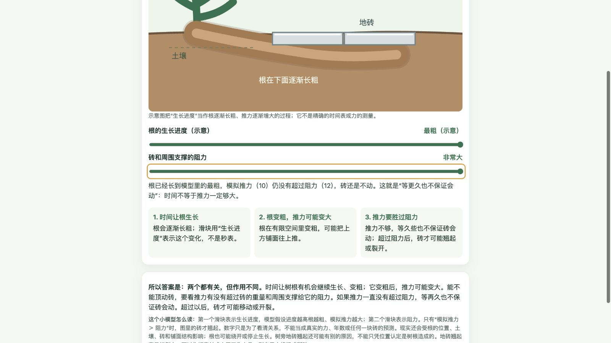

# 候选D修订与画像体验结果

日期：2026-10-24。**修订和本轮体验已完成；M3仍有未解决项：解释补充后，页面自动同步尚不稳定。** 五组新画像共16条用户消息，另有两项定点回看共3条；19次真实模型回合均完成。原始输出、初稿失败和反馈后恢复分别保留。

## 修订了什么

按[评审原文](../../../REVIEW_DIAGNOSIS_C.md)及本线程确认的取舍，合并准确性要求，保留决定结论的关系、量级和成立条件；定义保留区分条件；更正覆盖文字、标签及交互关系。核心概念进入主解释；页面允许普通来源链接，保持离线完整可用。Skill正文从2184字符减至2154字符。详细取舍见[CHANGES.md](CHANGES.md)。

候选D的Skill哈希为 `83aebcc590fdd1cd618d918896b79737a8cdda5e3e6a6106581ac6c85a78d341`，页面规范为 `89bd7b1cfc2e463836db1d689ba7ff2ea8782a37944a41a93c7d2bc05660c7ea`，整批未变。C、D正文快照分别位于[候选C](../../candidates/C/curiosity/SKILL.md)、[候选D](../../candidates/D/curiosity/SKILL.md)，旧样本未改。完整记录见[candidate.json](candidate.json)。

## 五组新画像：随机起题，读完才追问

仍通过Computer use在临时聊天入口输入、发送、阅读及操作生成页，后端为真实 `gpt-6-luna / high`。语言、历史、社会、工程观察、亲子自然五层各随机抽一题，种子 `12253412388480789828`，未重抽。模型只收到Skill和实际用户消息；画像档案、评分、标准术语及追问没有注入。完整池见[sampling.json](sampling.json)，运行边界见[METHOD.md](METHOD.md)。

| 画像与随机起点 | 实际探索路径 | 结果及证据 |
|---|---|---|
| P1，10岁孩子：同一个词意思不同 | “厉害”在爷爷／同学口中的区别→语境是什么→咳嗽为何也“厉害” | 3条。局部解释语境，继而引出多义词；用文字完成。[实录](P1/transcript.md)、[截图](P1-chat.png) |
| P2，14岁学生：战争记载差异 | 不同记载怎样判断→独立来源是不是作者互不认识→刷新时默认解释为空 | 3条。区分史实、材料、推断与评价；页面初始解释遗漏，经反馈修好。[实录](P2/transcript.md)、[家书状态](P2-page-letter.png)、[最终页](P2/artifacts/turn-3/curiosity-history-sources.html) |
| P3，成人初学者：广告换措辞更想买 | 省30%／付70%→是不是怕吃亏→原价不同但实付相同 | 3条。引出框架效应、损失厌恶、参照价格与锚定；保留条件，没有把一次偏好直接归因于某一机制。[实录](P3/transcript.md)、[参照价操作](P3-page-reference.png) |
| P4，工程背景：双音箱低音忽强忽弱 | 调到180°后图文不符→聊天解释后页面仍旧→关一只时又留着两路相消说明 | 4条。能讲总相位差与相干／振幅条件，但自动同步失效；两次明确页面反馈后恢复。[实录](P4/transcript.md)、[冲突状态](P4-page-one-speaker.png)、[最终说明](P4/artifacts/turn-4/curiosity-room-bass.html) |
| P5，家长陪7岁孩子：泡泡透明却有彩色 | 拖动厚度看颜色→窗玻璃为何不同→眼镜泛绿是否妨碍看清 | 3条。引出薄膜干涉和增透膜；区分反射、透射及具体镜片未知。[实录](P5/transcript.md)、[极薄状态](P5-page-thin.png)、[玻璃／眼镜说明](P5-page-final.png) |

Computer use实际点击了历史页的家书与来源链选项、广告页的措辞切换和折扣／参照价格滑块、音箱页的相位与音箱开关、泡膜厚度滑块；随后刷新检查模型修改后的图文。操作端没有手修生成HTML。P1没有交互增益，保持文字回答。

## 两项定点回看：与新画像分别记录

| 回看 | 输入与实际结果 | 证据 |
|---|---|---|
| P6，树根旧页 | 工作区放入C的S1第3轮副本，用户只描述矛盾并请求解释及改页。首次同时改了交互和文字，但推力上限10、阻力上限9，拉满仍必然顶起。第二条用户反馈后，阻力上限改为12；实际核验生长10／阻力12不动、生长10／阻力2抬升，图、箭头与说明对应 | [输入副本](P6/input-artifact/curiosity-tree-roots.html)、[输入哈希](P6/seed.json)、[实录](P6/transcript.md)、[首次修复](P6/artifacts/turn-1/curiosity-tree-roots.html)、[最终页](P6/artifacts/turn-2/curiosity-tree-roots.html)、[不动](P6-root-blocked.png)／[抬升](P6-root-moving-final.png) |
| P7，褪色概念 | 一条普通提问询问“光使染料氧化且变了，是否两个名称都适用”。回答保留形成更小分子片段的条件，推论也保留该条件。页面实际切换“碎裂”与“氧化”，两概念重合或分开时说明同步 | [实录](P7/transcript.md)、[页面](P7/artifacts/turn-1/curiosity-衣物褪色.html)、[两者都适用](P7-both.png)、[只有光降解](P7-degradation-only.png) |

树根采用明确声明的示意数值与模型假设，未把数值当作真实根力、砖重或年数。它最终展示了条件差异，但恢复依赖第二次用户反馈。P7说明这一条回看中定义与推论匹配所引IUPAC界限；一次正确回复不代表所有知识问题已解决。

## 尚未解决：自动同步的触发与覆盖

**P4再次出现“聊天解释已补，页面未改”。** 第2轮给出通用相位关系，却没有改HTML；[第1轮页面](P4/artifacts/turn-1/curiosity-room-bass.html)和[第2轮页面](P4/artifacts/turn-2/curiosity-room-bass.html)字节相同。用户第3条消息明确要求改页后，相位说明才动态更新；之后关闭音箱2，又发现“当前状态”仍说两路抵消，第4条反馈后才覆盖开关状态。最终恢复可查[页面](P4/artifacts/turn-4/curiosity-room-bass.html)和[截图](P4-page-corrected.png)。

初步判断：现行“结论或深度改变时同步”的要求，仍依赖模型主动识别用户是在纠正既有页面；识别和受影响状态覆盖没有稳定发生。这是本轮观察支持的失效位置，尚不能证明唯一内部成因。后续应先复核这一触发与交付责任，避免按音箱、树根分别再叠加知识规则。本批发现后继续保留D冻结，完成原定体验，没有边改提示词边记为通过。

还有两项局部问题保留：P2初稿默认选中却不显示解释，首次扩展页面时选项组曾互相影响，反馈后初始化与分组切换恢复；P5过程说明把网页极薄状态变暗说成“说明不是颜料”，该措辞容易把代码演示当成现实机制的证据。页面本身保留了模型限制。它们不应被最后一张正确截图掩盖。

## 验证到哪里

- **结构与版本**：`skill-creator`校验通过；抽样可复现；19次回合完成，七组后端错误均为空；候选哈希全程一致。结构记录见[verification.json](verification.json)。
- **页面与实际操作**：新探索生成4页，定点回看2页，均实际打开并操作。六份最终HTML静态检查未发现外部资源依赖或常见自动联网调用；普通来源链接保留。没有人为断网运行，也未对这批六页重新完成所有375px、键盘和无障碍项目。
- **语义与来源**：对历史方法、框架研究和褪色引用做了有限抽查。国会图书馆的[史料分析方法](https://www.loc.gov/programs/teachers/getting-started-with-primary-sources/)与页面方法相符；[消费信息研究](https://pmc.ncbi.nlm.nih.gov/articles/PMC7367006/)研究酒店情境下的省钱措辞，支持情境性影响，未被当作本例两句话必有固定效果的证明。P7所引[综述](https://doi.org/10.1016/j.dyepig.2022.110999)的题名、作者及论题已在出版社／[作者机构](https://dare.uva.nl/id/19f1a261-f47e-47d8-a34f-a7f0d4d589b9)核对。部分直接访问受403、超时或验证页面限制，使用了官方索引内容；未绕过验证。没有逐句完成独立专业审校。
- **效果与独立性**：实施者同时扮演并观察，已看过C的诊断；本轮不是独立盲测，没有真人理解、错误率下降或提速结论。生成端缺少浏览器工具，操作端核验另记；临时聊天页缓冲整轮回复，不代表Codex原生流式体验。

**收口：候选D修订已落地，5组画像和2项回看已执行，部分问题能经反馈恢复；M3仍不能记为全部通过。** 旧固定用例未重新全量运行，其结果保留为旧候选证据。报告形成时改动尚未提交或推送；后续同步见Git历史。未共享挂载，M4未开始。

## 文件入口

- 实现：[Skill正文](../../../curiosity/SKILL.md)、[页面规范](../../../curiosity/references/page-spec.md)、[修订取舍](CHANGES.md)。
- 原始资料：每组`P1`—`P7`目录内的`dialogue.json`保留实际输入、公开回复和工具记录；`transcript.md`便于阅读；`artifacts/turn-N/`保留该轮文件。
- 前序：[C体验](../2026-10-24/REPORT.md)、[C诊断](../../../DIAGNOSIS_C_2026-10-24.md)、[外部评审](../../../REVIEW_DIAGNOSIS_C.md)。

