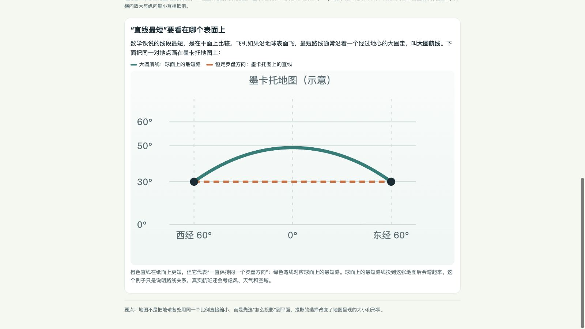

# 随机画像与自然追问体验记录

日期：2026-10-24。**这轮模拟体验已完成；首版实现已落盘，但不能据此宣布 M3 全部验收通过。** 五组虚构画像、随机起题、17 条用户消息均经 Computer use 输入和阅读，五个生成网页均实际打开并操作。它展示了从生活疑问走到新概念的可行路径，也暴露了内容精度与页面纠正不完整的问题。原稿、失败和后续纠正全部保留。

前一批 [结构化运行记录](../../runs/2026-10-24/REPORT.md)检查功能和回归，并不能替代本轮用户要求的随机画像探索。M4 真人试用仍未开始。取消额外安全审批的用户决定继续有效，本报告不增加安全关卡或待审批事项。

## 怎样进行

- 五个画像只由操作端持有，覆盖10岁孩子、14岁学生、成人初学者、工程背景成人、陪伴7岁孩子的家长。年龄或已知内容仅在自然用户消息中按需自述，没有额外向被测模型注入画像档案、评分规则或期望术语。
- 随机种子 `12977376108882928853`，从16条新生活观察中无放回抽取5条，未重抽。完整池与抽样结果见 [sampling.json](sampling.json)。本次随机结果集中在自然科学和数学，不能据此声称覆盖人文社科。
- 只随机选择起点；后续问题读完实际回答、操作实际页面后即时形成。没有预写追问或答案；也没有运行 `T*` 用例。扮演者本身知道一些相关知识，因此这不是无知识真人的盲测；尽量只沿用户当时看到的词语、矛盾和生活联想继续。
- Computer use 在本机 [临时聊天传输页](chat_transport.py)逐条输入、点击发送和阅读，后端接真实 Codex app-server，`gpt-6-luna / high`，每组独立 ephemeral 会话，后续保留上下文。仅复用旧脚本的 RPC 传输类，未复用用例、答案或评分器。模型可实际检索并在临时工作区写文件，操作端负责打开网页。
- 该聊天页是验收传输工具，不能证明 Codex 桌面原生聊天界面已经验收。回复在完整回合结束后才显示，等待体验不能代表宿主的真实流式体验。
- 整轮固定候选 C：Skill SHA-256 为 `d26bcbf818841ddcfd5d7534d73569bc5ce213dc54b4ff000696ad7c3fc2f624`。页面规范也与候选记录一致。运行中未改 Skill，操作端未手修生成页；页面变化都来自模型对实际用户反馈的响应。

方法细节见 [METHOD.md](METHOD.md)，即时观察见 [OBSERVATIONS.md](OBSERVATIONS.md)。实施智能体同时扮演用户和评审，不是独立外部评审。

## 实际探索路径

| 画像与起点 | 由回答和操作自然引出的追问 | 实际表现与问题 | 用户消息／实录 |
|---|---|---|---|
| 10岁孩子：软树根怎么顶地砖 | “楔子是什么”→没有肌肉怎么施力→小力等久了是否什么都顶得起→树皮开裂→页面两种说法冲突 | 能局部解释陌生词并继续联想；初稿强调“持续多久”造成误导，第一次纠正只补限制、未替换冲突原文，第二次指出后才修全 | 5，[S1](S1/transcript.md) |
| 14岁学生：地图上的大小怎么变 | 哪张才算画对→为何不用等面积→地图直线怎么不是最短路线 | 自行引出地图投影、墨卡托／等面积的用途取舍，再引出大圆航线；能承接学校的平面几何常识，沿用页面补图 | 3，[S2](S2/transcript.md) |
| 成人初学者：晒衣褪色 | 像生锈吗→放回柜子会恢复吗→页面资料中的光降解与氧化怎么联系 | 口吻平视、能继续讲关系；重要概念藏在资料栏，后续释义又比所引定义宽，仍有内容问题 | 3，[S3](S3/transcript.md) |
| 工程背景成人：云为何有白有黑 | 云滴和波长究竟多接近→光学厚度由什么量决定→粒径一直缩小还适用吗 | 不重讲已知散射，直接讲光学厚度、积分和近似边界，继续到 Mie／Rayleigh；初稿“尺寸相近”不准确，用户追问后才改 | 3，[S4](S4/transcript.md) |
| 家长陪7岁孩子：金属勺为何更冷 | 手凉时箭头反转→晒过的金属为何更烫→金属保温杯为何能保温 | 区分温度、接触传热、太阳加热和杯壁结构，主动引出双层真空；可切换单层杯与真空杯，未预先给它这些答案概念 | 3，[S5](S5/transcript.md) |

全部17次模型回合状态为 `completed`，五组后端错误均为空。它们证明对话与文件链路实际跑通，不等于知识内容全部正确。

## Computer use 实际操作

| 页面 | 实际操作及观察 | 证据 |
|---|---|---|
| 树根 | 滑块调到最粗，看到砖翘起；根据图文追问。第一次纠正后刷新发现原句仍在；第五轮后再次刷新确认原句与阶段标签被替换 | [中间状态](S1-page.png)、[最终状态](S1-page-final.png)、[最后对话](S1-chat.png) |
| 地图 | 将纬度从60°调到75°，面积失真示意改变；第三轮后刷新并滚动查看新增的直线路径与大圆航线对照 | [75°状态](S2-page.png)、[新增路线图](S2-page-route.png)、[对话](S2-chat.png) |
| 褪色 | 将光照累积滑块从35调到100，看到颜色与分子示意变化；滚动到资料区，因读到“光降解”才继续问 | [页面](S3-page.png)、[对话](S3-chat.png) |
| 云 | 将光学厚度从4调到9，直达光比例下降，页面保留“不是总亮度”限定；后两轮刷新核对尺度改正和近似边界 | [初稿](S4-page.png)、[最终说明](S4-page-final.png)、[对话](S4-chat.png) |
| 金属／保温杯 | 点击“手比房间凉”后热流箭头反转；后续刷新看到日晒解释和杯壁图，实际切换单层与真空两态，图文同步 | [冷手状态](S5-page.png)、[单层杯](S5-cup-single.png)、[真空杯](S5-cup-vacuum.png)、[对话](S5-chat.png) |

每轮生成文件均按 `Sn/artifacts/turn-N/` 保存；实录链接指向该轮副本，完整原始输入、公开回复、工具调用与时间见各组 `dialogue.json`。截图是部分画面证据，应结合实际操作记录阅读。本轮五页没有重新完成每页375px、离线和完整键盘验收，不能沿用两个样板的检查结果宣称这些新页面也全项合格。

## 对需求的判断

这轮支持“方法可行”的判断：用户可以只给日常描述，模型自行发现解释概念，并让后续问题从回答中长出来。地图和保温杯两组最清楚地呈现了这种过程，无需用户先掌握专业提问方法。没有看到前置知识测验、年龄问卷或每轮强迫用户选择下一方向。

轻量适应也有实际表现：孩子问陌生词时局部补释义；成人初学者没有被幼儿化称呼；专业画像能直接进入公式和近似条件。没有观察到显式读取 `eli5`／`show-me`，本轮由好奇心自行解释和生成网页；这说明该路径可独立运行，不据此新增“两技能协作效果已验证”的结论。

但“会继续讲”与“首次讲准”应分别评价，当前至少有以下不足：

1. **简化改变了因果重点，纠正又未同步替换原文。** S1 会让孩子形成“小力持续得够久就能顶起任意重物”的推论。最终能恢复，但依赖孩子再回看页面并指出矛盾；普通初学者未必能发现。
2. **专业讲解初稿仍会出现尺度错误。** S4 的后续深度有效，不能抵消先前“云滴与可见光波长相近”的说法。它在具体对话中已自行纠正，尚不能证明以后首次生成也可靠。
3. **关键概念不够显眼，来源与释义未严密对应。** S3 先把“光降解”放在资料栏。追问后，回答将它泛化为光引起的分子改变；其引用的 [IUPAC 光降解条目](https://goldbook.iupac.org/terms/view/P04595)包含生成较低分子量片段的限制，不能用该来源支撑所有光致变化都叫光降解。[光氧化条目](https://goldbook.iupac.org/terms/view/P04640)则定义光引起的氧化，二者不是必经先后阶段。这个精度问题在本组结束时仍未修正。
4. **生成页面仍有规范遗漏。** S5 使用可跳转来源链接，而当前规范要求页面内用文本来源。原样留存；操作端没有替它修好再记为首次合格。

IUPAC 核对是在 S3 对话后由评审侧进行，未向模拟用户提前提供答案。原站直接访问遇到403／安全验证，比较依据是官方条目检索返回的定义文本；未绕过站点验证，也未改变系统时间。此处只核对具体引用匹配，不代表对五组知识逐句完成独立专业审校。

## 当前收口与后续处理位置

**首版实现完成；结构化回归及本轮随机画像体验均已执行；M3 暂不记为全部通过。** 尚有 S3 术语释义、S5 页面外链，以及 S1 暴露的纠正一致性需要处理和复验。S1、S4 的具体页面已由对话自行纠正，原始错误仍保留作为证据。

本轮按用户要求先完成冻结版本的自然体验，未把失败逐条写成新增提示词规则。后续最小修正应归入已有职责：概念命名与来源释义、可靠性中的简化边界、页面更新时替换冲突说明、已有纯文本来源契约。修正后应保留这批原始记录，另记实际再体验的表现；不能只把这五个故事答对就宣称泛化改善。

这是模型模拟，不是孩子或成人的真实理解证据；没有统计提速、全人群适用、跨宿主兼容或长期稳定性结论。M4 尚未开始。报告形成时新增工作尚未提交或推送；未共享挂载。后续同步见Git历史。最终核对了抽样复现、五组17次回合的完成状态、候选四份文件哈希未变、各轮页面和报告的本地链接；文档差异检查无空白错误。这些结构检查不改变前述内容问题结论。

